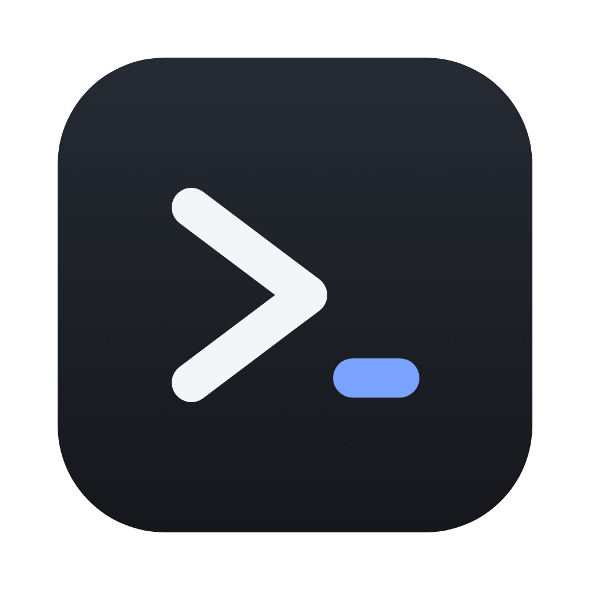
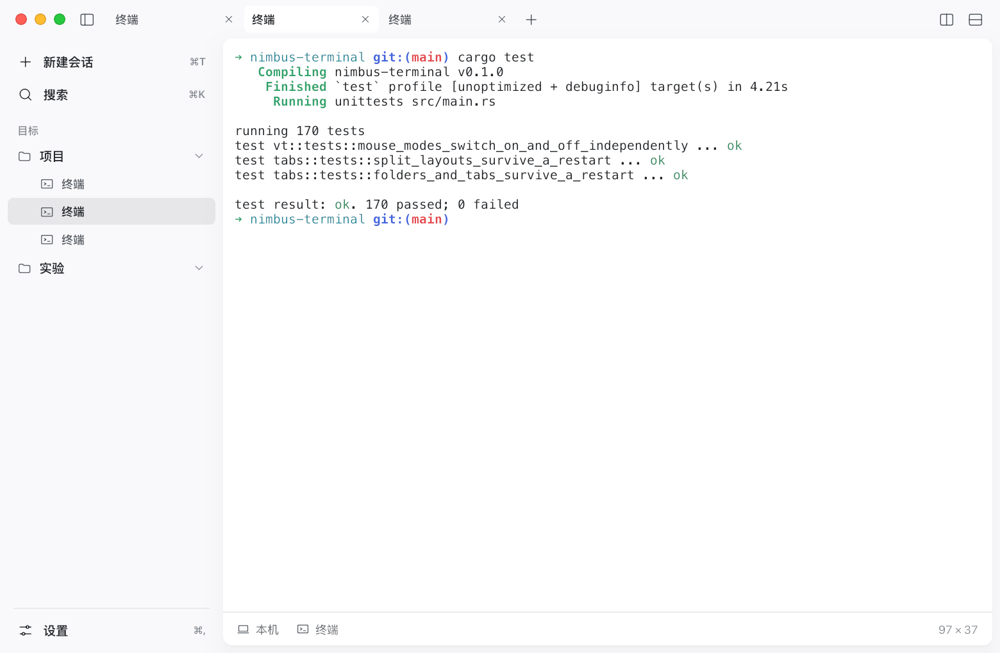
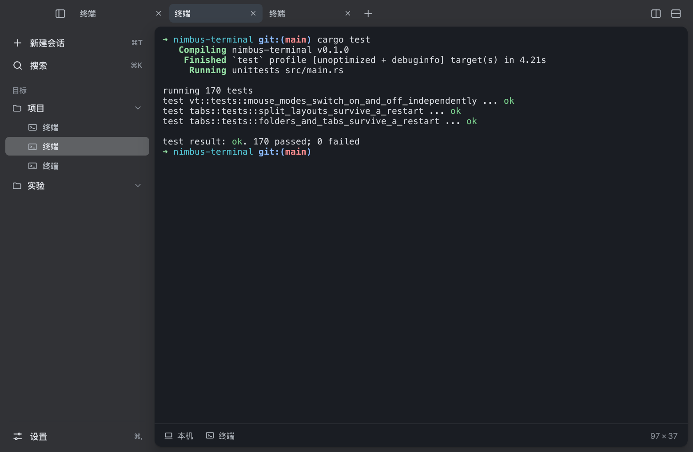

<div align="center">



# Nimbus

**A clean terminal that remembers where you left off.**

Built from scratch on the [Aureole](https://github.com/ruoyu-lab/aureole) UI framework, with its own pty and xterm emulation. No WebView, no Electron.

[](LICENSE)


[中文](README.md)

</div>

<div align="center">
  
  
</div>

## Features

- **Terminal**: own pty and xterm emulation (256/true color, mouse reporting, bracketed paste, alternate screen, scrollback, wide CJK characters), horizontal and vertical splits, context menu, configurable cursor and font
- **Links, images, search**: Cmd-click URLs and file paths (OSC 8 hyperlinks too), inline images (iTerm2, Kitty, Sixel), in-terminal search (Cmd-F), font zoom (Cmd +/-/0), drop files from Finder to type their paths
- **Shell integration (OSC 133)**: zsh loads it automatically without touching your config; jump between commands (Cmd-Up/Down), copy the last output, background notifications when a command finishes, command history search in the palette; marks survive restarts
- **Servers and containers**: SSH hosts from `~/.ssh/config` and Docker containers as sidebar targets; a right panel with monitoring and a file browser (upload/download) shows up only for remote sessions
- **Workspace**: draggable tabs, sidebar "targets" with folders (drop a directory from Finder and new terminals start there), command palette (⌘K)
- **Remembers**: tabs, split layouts, working directories **and terminal contents** are restored on launch; the window position and size are stored **per display and per scale factor**, so it never ends up off-screen
- **Appearance**: light, dark, or follow the system; the whole UI and the terminal switch together

## Install

macOS only for now (Linux uses the same `forkpty` interface but is untested on a desktop; on Windows the local terminal works through ConPTY, but there is no installer yet and SSH monitoring, the files page and shell integration are still in progress, see docs/windows.md). Requires Rust 1.90+.

```bash
git clone https://github.com/ruoyu-lab/nimbus-terminal.git
cd nimbus-terminal
cargo run --release            # run it
scripts/bundle-macos.sh        # or build target/bundle/Nimbus.app
```

> **Note**: the Aureole framework is still a private repository, so the project can only be built by people who have access to it until the framework is made public.

Configuration lives in `~/Library/Application Support/Nimbus/` (override with `NIMBUS_HOME`).

## Contributing

Issues and pull requests are welcome, see [CONTRIBUTING.md](CONTRIBUTING.md).

## License

[MIT](LICENSE) © 2026 ruoyu-lab
