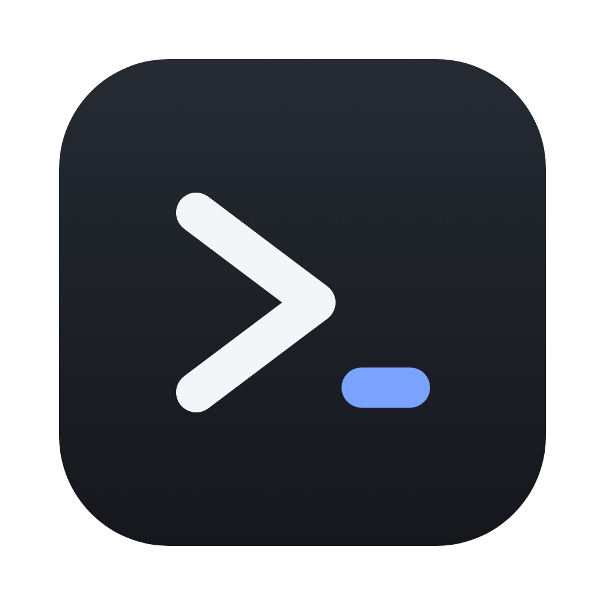
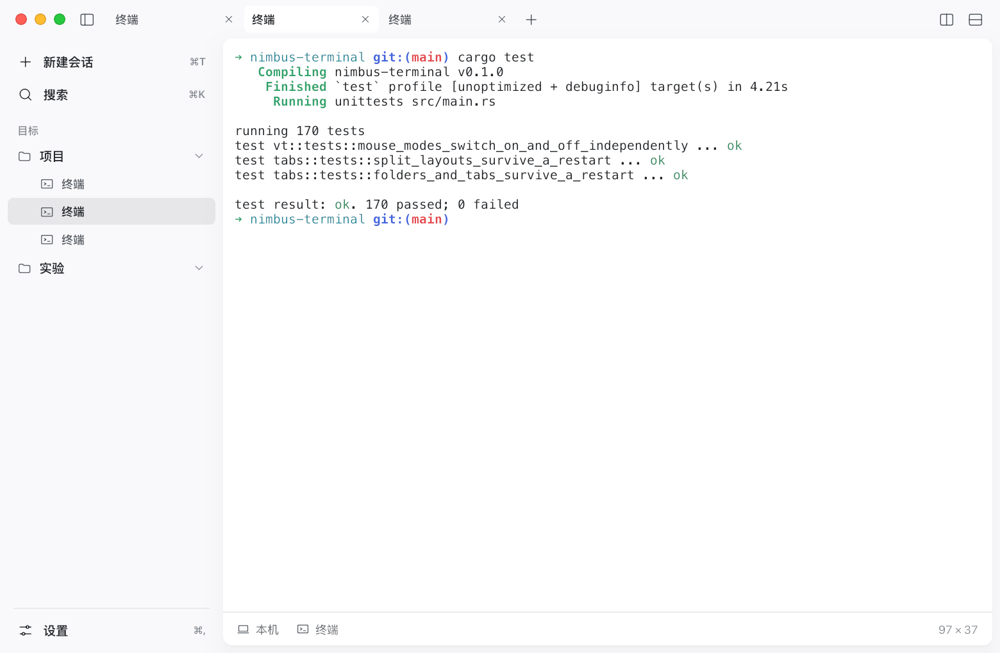
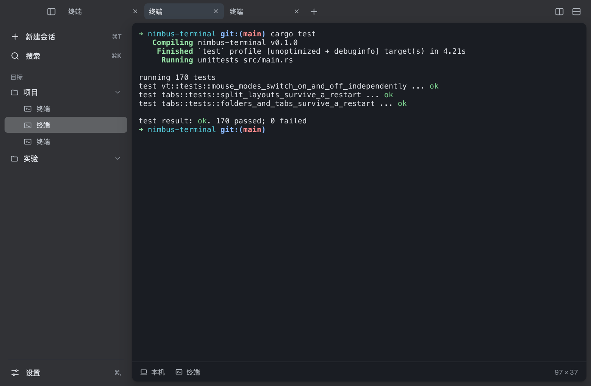
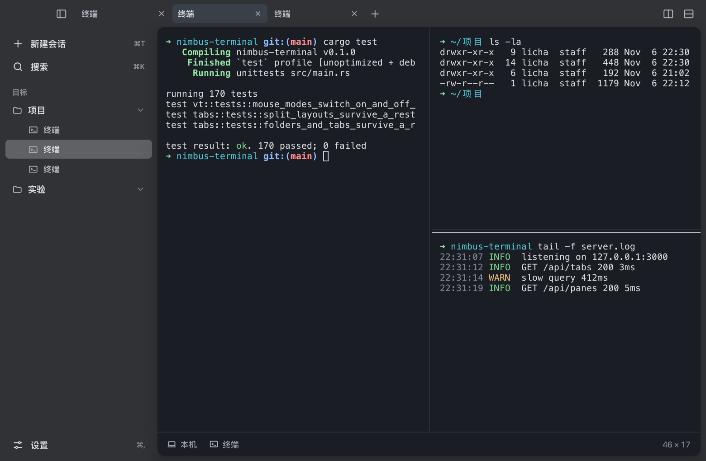
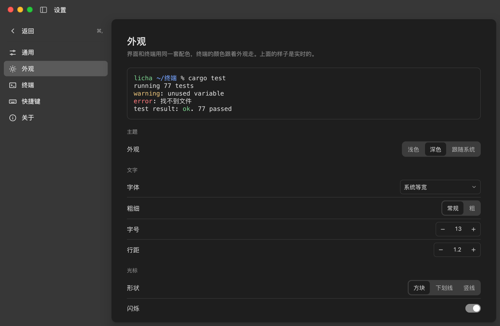

<div align="center">



# Nimbus

**一个干净、好看、能记住你工作现场的终端。**

用 [Aureole](https://github.com/ruoyu-lab/aureole-framework) 界面框架从零写成：自研 pty 和 xterm 仿真，没有 WebView，没有 Electron。

[](LICENSE)


[](https://github.com/ruoyu-lab/aureole-framework)

[特性](#特性) · [截图](#截图) · [安装](#安装) · [快捷键](#快捷键) · [配置](#配置) · [开发](#开发) · [English](README.en.md)

</div>

<div align="center">
  
  
</div>

## 特性

**终端本身**

- 自研 pty 与 xterm 仿真：256 色和真彩、鼠标上报、括号粘贴、备用屏（vim、less、htop 都能用）、滚动历史、中日韩宽字符
- 左右、上下分屏，分隔条可拖，拆出来的终端从当前目录起
- 右键菜单：复制、粘贴、全选、清屏、拆分、关闭分屏
- 光标形状和闪烁、字体、字号、行距、字体粗细、响铃（提示音或画面闪一下）

**工作区**

- 标签条可拖动换位，拖动时只左右移动、松手平滑落位
- 侧栏的「目标」：新建文件夹，或者**直接把访达里的目录拖进来**，之后在里面开的终端都从那个目录起
- 命令面板（⌘K）：搜索会话、执行命令
- 有程序在跑时关闭先确认

**记住你的现场**

- 重启后恢复标签、分屏排布、每个终端所在的目录，连**终端里的内容**（带颜色）一起带回来
- 窗口的大小和位置**按显示器分别记**，缩放比例、分辨率变了也不会把窗口丢到屏幕外面
- 设置、文件夹、侧栏宽度都会存下来

**外观**

- 浅色、深色、跟随系统，整个界面和终端一起换
- 设置页里每一项都是真的，改了马上生效

## 截图

<div align="center">
  
  
</div>

> 截图是离屏渲染的，没有系统的窗口材质；真机上侧栏是半透明的毛玻璃。

## 安装

目前只支持 **macOS**（pty 用的是 `forkpty`，Linux 同一套接口但没有在桌面上测过，Windows 的 ConPTY 还没写）。

需要 Rust 1.90 或更新（edition 2024）。

```bash
git clone https://github.com/ruoyu-lab/nimbus-terminal.git
cd nimbus-terminal

# 直接跑
cargo run --release

# 或者打包成 .app（target/bundle/Nimbus.app，带图标，用临时签名）
scripts/bundle-macos.sh
```

界面框架 Aureole 是 Git 依赖，`cargo` 会自己拉取，不需要另外装。

> **注意**：Aureole 目前还是私有仓库，没有访问权限的话 `cargo` 拉不下来、编译不了。框架公开之前，这个项目只有能访问它的人才能构建。

## 快捷键

| 操作 | 快捷键 |
| --- | --- |
| 新建会话 | `⌘T` |
| 关闭当前终端（拆分过的）/ 标签；设置页里是返回 | `⌘W` |
| 左右分屏 / 上下分屏 | `⌘D` / `⌘⇧D` |
| 命令面板 | `⌘K` |
| 收起 / 展开侧栏 | `⌘B` |
| 打开 / 退出设置 | `⌘,` |
| 切到第 1–8 个标签 / 最后一个 | `⌘1`–`⌘8` / `⌘9` |
| 上一个 / 下一个标签 | `⌘⇧[` `⌘⇧]`，`Ctrl+Tab` |
| 粘贴 | `⌘V` |

## 配置

配置放在 `~/Library/Application Support/Nimbus/`（用环境变量 `NIMBUS_HOME` 可以改位置）：

| 文件 | 内容 |
| --- | --- |
| `settings.json` | 设置页里的所有选项 |
| `state.json` | 侧栏的文件夹、开着的标签和分屏排布、侧栏宽度 |
| `window.json` | 窗口的位置和大小（每块显示器、每种缩放各一份） |
| `output-N.ansi` | 各个终端里的内容 |
| `crash.log` | 出过 panic 时的原因和调用栈 |

设置页的「关于」里点「恢复默认」可以清掉所有设置。

## 开发

```bash
cargo fmt --check
cargo clippy --all-targets
cargo test
```

测试里有几类需要真实环境：起真 shell 的（要能 `forkpty`）、离屏截图的（要有 GPU 适配器）。界面部分用框架的 `Harness` 离屏测试，不需要窗口。

分层，从下往上：

| 层 | 职责 |
| --- | --- |
| `pty` | 起子进程、搬字节、改窗口大小（跨平台的接缝是 `PtyBackend`） |
| `vt` | 把字节流解析成屏幕模型；键盘、鼠标的编码也在这里 |
| `view` | 把屏幕模型同步到框架的字符网格，管终端配色 |
| `app` | 一个终端会话：把上面三者接到一块网格上 |
| `pane` / `tabs` | 分屏的树、窗口的状态（标签、文件夹、设置页、命令面板） |
| `store` / `settings` / `display` | 落盘、设置项、窗口位置按显示器分别记 |
| `chrome` | 界面：标题栏、侧栏、卡片、命令面板、设置页 |

重新生成 README 里的截图：

```bash
README_SHOTS=$PWD/docs/screenshots cargo test screenshots_for_readme -- --ignored
```

欢迎提 issue 和 PR，先看看 [CONTRIBUTING.md](CONTRIBUTING.md)。改动记录在 [CHANGELOG.md](CHANGELOG.md)。

## 致谢

- [Aureole](https://github.com/ruoyu-lab/aureole-framework)：界面框架，字符网格、布局、动画、输入、离屏测试都来自它
- [Feather](https://feathericons.com/)（MIT）：GitHub 图标

## 许可证

[MIT](LICENSE) © 2026 ruoyu-lab
